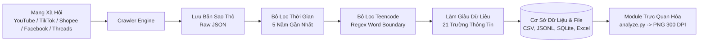

<div align="center">

# 🌐 SOCIAL MEDIA COMMENT CRAWLER & TEENCODE ANALYTICS
### *Hệ Thống Thu Thập Bình Luận Mạng Xã Hội & Phân Tích Từ Viết Tắt (Nhiệm Vụ 18)*

[](https://www.python.org/)
[](LICENSE)
[](#-hướng-dẫn-chọn-nền-tảng-mỗi-nhóm-1-nền-tảng)
[](https://github.com/psf/black)
[](#)

<p align="center">
  <b>Thu thập dữ liệu bình luận 5 năm gần nhất (2021 – 2026) • Nhận diện Teencode chuẩn xác cao • Trích xuất tối đa 21 trường thông tin • Xuất đa định dạng CSV/JSONL/SQLite/Excel</b>
</p>

</div>

---

## 📌 Mục Lục (Table of Contents)
- [1. Giới Thiệu Nhiệm Vụ 18](#1-giới-thiệu-nhiệm-vụ-18)
- [2. Tính Năng Nổi Bật (Key Features)](#2-tính-năng-nổi-bật-key-features)
- [3. Kiến Trúc Hệ Thống (Architecture)](#3-kiến-trúc-hệ-thống-architecture)
- [4. Danh Mục Tài Liệu Chi Tiết (Documentation Suite)](#4-danh-mục-tài-liệu-chi-tiết-documentation-suite)
- [5. Cài Đặt & Khởi Động Nhanh (Quickstart)](#5-cài-đặt--khởi-động-nhanh-quickstart)
- [6. Hướng Dẫn Chọn Nền Tảng (Mỗi Nhóm 1 Nền Tảng)](#6-hướng-dẫn-chọn-nền-tảng-mỗi-nhóm-1-nền-tảng)
- [7. Bảng Đặc Tả 21 Trường Dữ Liệu (Schema)](#7-bảng-đặc-tả-21-trường-dữ-liệu-schema)
- [8. Phân Tích & Vẽ Biểu Đồ Báo Cáo (EDA)](#8-phân-tích--vẽ-biểu-đồ-báo-cáo-eda)
- [9. Đóng Góp & Tác Quyền](#9-đóng-góp--tác-quyền)

---

## 1. Giới Thiệu Nhiệm Vụ 18

> **Đề bài:** Thu thập comment trên **YouTube / Facebook / TikTok / Shopee / Threads** (lấy những comment có từ viết tắt *"ngta, m, cx,..."*), càng nhiều trường thông tin càng tốt. Mỗi nhóm chọn 1 nền tảng, thu thập trong thời gian **5 năm gần nhất**.

Dự án này cung cấp một bộ khung (Framework) hoàn chỉnh, độc lập và dễ mở rộng, cho phép sinh viên và nhóm nghiên cứu thu thập, làm sạch, phân tích và trực quan hóa dữ liệu ngôn ngữ mạng (Teencode) phục vụ các đề tài Khoa học Dữ liệu, Xử lý Ngôn ngữ Tự nhiên (NLP) và Khai phá Dữ liệu (Data Mining).

---

## 2. Tính Năng Nổi Bật (Key Features)

- 🎯 **Lọc Teencode Không Bắt Nhầm (Zero False Positives):** Sử dụng Regex Negative Lookbehind/Lookahead `(?<!\w)...(?!\w)` đảm bảo chữ `m` không bị bắt nhầm trong `làm`, chữ `k` không bị dính vào `like`.
- 📅 **Lọc Tự Động 5 Năm Gần Nhất:** Chuẩn hóa thời gian về múi giờ Việt Nam (`UTC+7`), tự động loại trừ các bình luận quá 5 năm so với thời điểm cào.
- 📋 **Trích Xuất 21 Trường Dữ Liệu Chi Tiết:** Đầy đủ thông tin về bài viết, tác giả, nội dung, phản hồi, chỉ số cảm xúc và metadata mở rộng.
- ⚡ **Hỗ Trợ 5 Nền Tảng Lớn:** YouTube (API & Scraper), Shopee (Ratings API), TikTok, Facebook, Threads.
- 💾 **Xuất Đa Định Dạng:** Tự động lưu trữ đồng thời ra `CSV (UTF-8 with BOM)`, `JSON Lines`, `SQLite DB` và `Excel`.
- 📊 **Tích Hợp Sẵn Module Phân Tích & Trực Quan Hóa (EDA):** Tự động vẽ biểu đồ phân phối tần suất từ viết tắt và xu hướng qua từng năm.

---

## 3. Kiến Trúc Hệ Thống (Architecture)



---

## 4. Danh Mục Tài Liệu Chi Tiết (Documentation Suite)

Để nghiên cứu sâu hơn về từng khía cạnh, vui lòng xem các tài liệu chuyên ngành trong thư mục [`docs/`](docs/):

- 📘 [**docs/ARCHITECTURE.md**](docs/ARCHITECTURE.md): Kiến trúc module, luồng dữ liệu (Data Pipeline) và mẫu thiết kế OOP.
- 📗 [**docs/DATA_SCHEMA.md**](docs/DATA_SCHEMA.md): Chi tiết 21 trường dữ liệu, kiểu dữ liệu, ràng buộc và bản ghi JSON mẫu.
- 📙 [**docs/PLATFORM_GUIDE.md**](docs/PLATFORM_GUIDE.md): Cẩm nang cào dữ liệu cho từng nền tảng, cách trích xuất ID/URL và kỹ thuật vượt anti-bot.
- 📕 [**docs/TEENCODE_GUIDE.md**](docs/TEENCODE_GUIDE.md): Cơ chế toán học NLP, biểu thức chính quy, công thức tính mật độ Teencode.
- 🤝 [**CONTRIBUTING.md**](CONTRIBUTING.md): Quy chuẩn đóng góp mã nguồn và cách bổ sung từ vựng mới vào từ điển.

---

## 5. Cài Đặt & Khởi Động Nhanh (Quickstart)

### Bước 1: Clone Repository & Cài Đặt Môi Trường
```bash
git clone https://github.com/AuNguyen365/Nhiem_vu_18.git
cd Nhiem_vu_18
pip install -r requirements.txt
```

### Bước 2: Chạy Thử Nghiệm Ngay Với Chế Độ DEMO
Lệnh này sẽ chạy mô phỏng toàn bộ quy trình lọc trên dữ liệu mẫu chuẩn thực tế mà không cần mạng internet:
```bash
python main.py --demo
```

### Bước 3: Xem Báo Cáo Thống Kê & Vẽ Biểu Đồ Tự Động
```bash
python analyze.py
```
*Biểu đồ phân tích chất lượng cao sẽ được xuất ra thư mục `reports/`.*

---

## 6. Hướng Dẫn Chọn Nền Tảng (Mỗi Nhóm 1 Nền Tảng)

Mỗi nhóm chọn **1 nền tảng duy nhất** bằng cờ `-p` (`--platform`):

| Nền Tảng | Lệnh Chạy Mẫu | Gợi Ý Nguồn Dữ Liệu |
| :---: | :--- | :--- |
| **YouTube** | `python main.py -p youtube -i "URL_VIDEO" --max 1000` | Các video ca nhạc, Vlog giới trẻ, tin tức thịnh hành |
| **Shopee** | `python main.py -p shopee -i "URL_SAN_PHAM" --max 1000` | Quần áo thời trang Gen Z, mỹ phẩm, phụ kiện điện thoại *(rất nhiều teencode)* |
| **TikTok** | `python main.py -p tiktok -i "URL_TIKTOK_VIDEO" --max 500` | Video viral triệu view, nội dung hài hước |
| **Facebook** | `python main.py -p facebook -i "URL_BAI_VIET" --max 500` | Bài đăng fanpage cộng đồng, confession sinh viên |
| **Threads** | `python main.py -p threads -i "URL_THREADS_POST" --max 500` | Bài đăng thảo luận xu hướng của giới trẻ Meta |

*Tùy chỉnh danh sách từ cần lọc thông qua tham số `-w` (ví dụ: `-w "ngta,m,cx,k,mik"`).*

---

## 7. Bảng Đặc Tả 21 Trường Dữ Liệu (Schema)

| STT | Trường (`Field`) | Kiểu | Mô Tả |
| :---: | :--- | :---: | :--- |
| 1 | `comment_id` | String | ID định danh duy nhất |
| 2 | `parent_id` | String / Null | ID bình luận cha (nếu là reply) |
| 3 | `platform` | String | Nền tảng (youtube, tiktok, shopee, facebook, threads) |
| 4 | `post_id` | String | ID bài viết / video / sản phẩm |
| 5 | `post_url` | String | Link URL gốc |
| 6 | `post_title` | String | Tiêu đề bài viết / video |
| 7 | `author_id` | String | ID người bình luận |
| 8 | `author_name` | String | Tên hiển thị người bình luận |
| 9 | `author_avatar_url` | String | Link ảnh đại diện |
| 10 | `comment_text` | String | Nội dung bình luận thô |
| 11 | `cleaned_text` | String | Nội dung sau khi chuẩn hóa |
| 12 | `created_at` | String | Thời gian đăng (ISO 8601 UTC) |
| 13 | `created_at_vn` | String | Thời gian đăng theo giờ Việt Nam (UTC+7) |
| 14 | `year` | Integer | Năm đăng (2021, 2022, 2023, 2024, 2025, 2026) |
| 15 | `likes_count` | Integer | Số lượt thích |
| 16 | `reply_count` | Integer | Số lượt phản hồi |
| 17 | `has_teencode` | Boolean | True (chứa từ viết tắt) |
| 18 | `detected_teencodes` | List/JSON | Danh sách từ viết tắt tìm thấy (vd: `["ngta", "m", "cx"]`) |
| 19 | `teencode_count` | Integer | Tổng số từ viết tắt trong câu |
| 20 | `teencode_density` | Float (%) | Tỷ lệ từ viết tắt / tổng số từ trong câu |
| 21 | `extra_metadata` | JSON | Thông tin mở rộng (rating sao Shopee, variant, v.v.) |

---

## 8. Phân Tích & Vẽ Biểu Đồ Báo Cáo (EDA)

Chạy script phân tích để xuất các đồ thị trực quan hóa phục vụ báo cáo:
```bash
python analyze.py data/processed/demo_platform/demo_output_demo_platform.csv
```

Kết quả biểu đồ sẽ được lưu dưới định dạng ảnh độ phân giải cao tại thư mục `reports/analysis_charts_*.png`:
- **Biểu đồ 1:** Top 12 từ viết tắt tiếng Việt xuất hiện phổ biến nhất trong tập dữ liệu.
- **Biểu đồ 2:** Phân bố khối lượng bình luận theo từng năm trong khoảng thời gian 5 năm.

---

## 9. Đóng Góp & Tác Quyền

- Dự án được phát triển phục vụ **Nhiệm vụ 18** - Học phần Khai Phá Dữ Liệu / Xử Lý Ngôn Ngữ Tự Nhiên.
- Bản quyền thuộc về **[AuNguyen365](https://github.com/AuNguyen365)**.
- Giấy phép phân phối: [MIT License](LICENSE).
