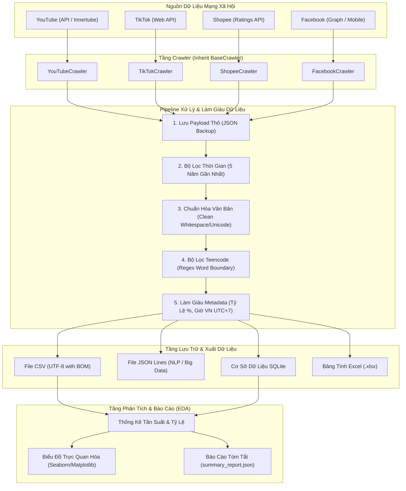

# Kiến Trúc Hệ Thống (System Architecture)

Tài liệu này mô tả chi tiết kiến trúc tổng thể, luồng xử lý dữ liệu (Data Pipeline), và các nguyên tắc thiết kế được áp dụng trong dự án.

---

## 1. Sơ Đồ Kiến Trúc Tổng Thể

Hệ thống được thiết kế theo mô hình **Pipeline-driven Modular Architecture**:

---

## 2. Các Thành Phần Cốt Lõi (Core Modules)

### 2.1. `core.base_crawler.BaseCrawler`
Lớp cha trừu tượng định nghĩa khung sườn xử lý nhất quán cho tất cả các nền tảng:
- Áp dụng mẫu thiết kế **Template Method Pattern**: Phương thức `run()` điều phối tuần tự quy trình `fetch -> backup -> filter -> enrich -> export -> report`.
- Các lớp con chỉ cần cài đặt logic đặc thù của nền tảng trong `fetch_raw_comments()` và `parse_comment_item()`.

### 2.2. `core.teencode_filter.TeencodeFilter`
Module xử lý ngôn ngữ tự nhiên (NLP) nhẹ chuyên biệt cho tiếng Việt:
- Tải từ điển từ `config/teencode_dict.json`.
- Biên dịch sẵn các biểu thức chính quy (Regex) với cơ chế ranh giới từ `(?<!\w)từ(?!\w)` đảm bảo hiệu năng cao khi duyệt hàng chục nghìn bình luận.
- Tính toán mật độ teencode:
  $$\text{Teencode Density} = \frac{\text{Số từ viết tắt phát hiện}}{\text{Tổng số từ trong bình luận}} \times 100\%$$

### 2.3. `core.data_exporter.DataExporter`
Chịu trách nhiệm lưu trữ và định dạng dữ liệu:
- Tự động khử trùng lặp (Deduplication) theo `comment_id`.
- Đảm bảo tính toàn vẹn của schema 21 trường thông tin.
- Xuất đồng thời đa định dạng phục vụ nhiều mục đích khác nhau (phân tích bảng biểu, huấn luyện mô hình học máy, hoặc lưu trữ quan hệ).
